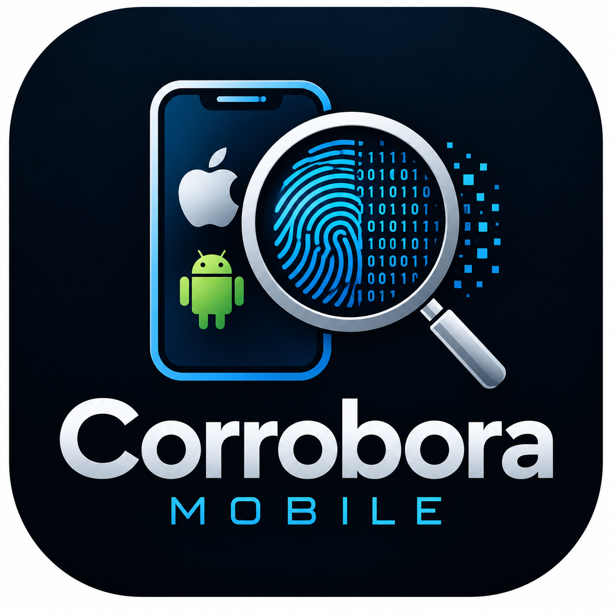

<p align="center">
  
</p>

# Corrobora Mobile

### Open-Source iOS & Android Full-File-System Forensic Acquisition Framework

**Developed by [Corrobora Technologies LLC](https://corroboratechnologies.com)**

**Project Status:** Pre-Alpha | Research & Development

---

## Overview

**Corrobora Mobile** is an open-source digital forensic research and
development project focused on full-file-system (FFS) acquisition
from supported iOS and Android mobile devices.

The project's primary objective is to research and develop
transparent, reproducible, and forensically documented acquisition
methods capable of obtaining filesystem-level evidence from
mobile devices.

A major long-term research objective is to investigate FFS
acquisition from ordinary, unmodified mobile devices, including
locked devices where technically feasible.

Corrobora Mobile is being developed with independent forensic
examiners, smaller forensic laboratories, and the broader
digital forensic community in mind.

The project aims to make mobile forensic acquisition research
more accessible while maintaining an emphasis on evidence
integrity, transparency, and validation.

> **Development Notice**
>
> Corrobora Mobile is currently in the early research and
> development stage.
>
> The project does not currently provide validated FFS
> acquisition capabilities.
>
> Device compatibility, extraction methods, and supported
> functionality will be documented as development progresses.

---

## Project Mission

To develop an open-source mobile forensic acquisition framework
that enables investigators and forensic examiners to acquire,
preserve, and document full-file-system evidence from supported
iOS and Android devices.

The project emphasizes:

- Open-source development and transparency.
- Device-specific FFS acquisition research.
- Evidence preservation and integrity.
- Reproducible forensic acquisition methods.
- Accurate device compatibility reporting.
- Independent testing and validation.
- Accessibility for smaller forensic laboratories.

---

## Primary Objectives

### 1. Full-File-System Acquisition

Research and develop methods for acquiring filesystem-level
evidence from supported mobile devices.

Planned research areas include:

- iOS full-file-system acquisition.
- Android full-file-system acquisition.
- Acquisition from supported unmodified devices.
- Acquisition from supported locked devices.
- Preservation of private application data where accessible.
- Preservation of filesystem structures and metadata.
- Documentation of acquisition scope and limitations.

**FFS acquisition is the primary focus of this project.**

Logical acquisition and backup-based workflows may be
supported as secondary capabilities.

### 2. Device Compatibility Research

Develop a device compatibility framework that documents:

- Manufacturer and device model.
- Operating system and version.
- Security configuration.
- Required device state.
- Supported acquisition methods.
- Required privileges.
- Known acquisition limitations.
- Validation status.

Device support will not be advertised without documented
testing.

### 3. Evidence Integrity

Develop evidence preservation functionality, including:

- SHA-256 hashing.
- Acquisition manifests.
- Acquisition timestamps.
- Audit logging.
- Error reporting.
- Documentation of device modifications.
- Integrity verification.
- Preservation of available filesystem metadata.

### 4. Forensic Acquisition Transparency

Document how each supported acquisition method operates,
including:

- Technical prerequisites.
- Device and operating-system compatibility.
- Acquisition scope.
- Known limitations.
- Potential changes to source devices.
- Validation procedures.
- Reproducibility requirements.

### 5. Forensic Analysis Integration

Corrobora Mobile will initially focus on acquiring and
preserving forensic evidence rather than duplicating
existing analysis applications.

Future development may explore integration with:

- [Chronoscope](https://github.com/Gear-I/Chronoscope)
- [Corrobora](https://github.com/Gear-I/Corrobora)

These integrations are planned research directions and
are not currently implemented.

---

## Supported Platforms

| Platform | Research Status | FFS Acquisition |
|----------|-----------------|-----------------|
| Apple iOS | Initial research documented; no implementation | Not implemented |
| Google Android | Emulator proof of concept in development | Not implemented |

The first Android target is a privileged acquisition of `/data` from a
`userdebug` Android Emulator image. That acquisition is classified
`PRIVILEGED_SELECTED_DIRECTORY`, **not** FFS (see
[docs/ARCHITECTURE.md](docs/ARCHITECTURE.md), Section 0.2). Its method
status is **UNVERIFIED**.

### Important Compatibility Notice

FFS acquisition capabilities depend on factors including:

- Device hardware.
- Operating system version.
- Security patch level.
- Device encryption.
- Device lock state.
- Available acquisition methods.
- Device-specific security restrictions.

Not all devices will be supported.

A successful logical extraction or encrypted backup does
not constitute a full-file-system extraction.

FFS acquisition also does not guarantee recovery of
deleted messages or other deleted artifacts.

---

## Development Roadmap

### Phase 1 — Research and Architecture

**Status: Complete (initial)**

- [x] Establish the project architecture
  ([docs/ARCHITECTURE.md](docs/ARCHITECTURE.md)).
- [x] Research documented iOS acquisition methods (initial survey;
  no documented open method identified for A12 and later devices).
- [x] Research documented Android acquisition methods (initial survey).
- [x] Define device compatibility requirements.
- [x] Design the modular FFS acquisition framework.
- [x] Establish evidence integrity requirements.
- [x] Develop an initial validation methodology
  ([docs/VALIDATION.md](docs/VALIDATION.md)).

### Phase 2 — Privileged Acquisition Proof of Concept (Milestone M1)

**Status: In progress**

The first proof of concept targets a `userdebug` Android Emulator,
not a physical device, and acquires `/data` only. It is classified
`PRIVILEGED_SELECTED_DIRECTORY`, not FFS.

- [x] Identify a research target (Android Emulator, `userdebug` image).
- [ ] Establish a documented privileged acquisition method
  (documented and registered as UNVERIFIED; not yet implemented).
- [ ] Develop the first privileged acquisition module
  (device detection, access provider and acquirer: not started).
- [ ] Acquire filesystem data from the test target.
- [ ] Preserve available filesystem metadata (designed; not implemented).
- [x] Generate SHA-256 evidence hashes (implemented and unit-tested;
  not yet used on device data).
- [x] Produce acquisition manifests and logs (implemented and
  unit-tested; not yet used on device data).
- [ ] Validate acquisition results (verification tools built; no
  acquisition validated).

### Phase 3 — Expanded Device Support

**Status: Planned**

- [ ] Research additional iOS device configurations.
- [ ] Research additional Android device configurations.
- [ ] Expand device-specific acquisition modules.
- [ ] Improve compatibility reporting.
- [ ] Investigate acquisition methods for unmodified devices.
- [ ] Investigate locked-device acquisition where feasible.

### Phase 4 — Forensic Workflow Integration

**Status: Planned**

- [ ] Develop standardized evidence exports.
- [ ] Explore Chronoscope integration.
- [ ] Explore Corrobora integration.
- [ ] Develop forensic acquisition reporting.
- [ ] Expand validation documentation.

---

## Technical Architecture

The architecture separates device communication, acquisition,
evidence handling, compatibility and validation. The full design is in
[docs/ARCHITECTURE.md](docs/ARCHITECTURE.md).

Current repository layout:

```text
Corrobora-Mobile/
│
├── docs/
│   ├── ARCHITECTURE.md        # design, decisions, milestone M1
│   ├── EVIDENCE_FORMAT.md     # evidence package specification
│   └── VALIDATION.md          # validation rules and records
│
├── compatibility/
│   └── methods/               # one reviewable record per method
│
├── src/
│   └── corrobora_mobile/
│       ├── core/              # shared models, errors, clock, paths
│       ├── audit/             # hash-chained audit log
│       ├── evidence/          # write-once evidence package, hashing
│       ├── acquisition/       # reconciliation and completeness checks
│       └── compatibility/     # registry, assessment, gate
│
├── tools/
│   ├── verify_package.py      # standalone verifier (standard library only)
│   └── validate_evidence_component.py
│
└── tests/
```

Platform modules (Android detection, access providers and acquirers)
have not been implemented yet. All implemented components are
unit-tested on synthetic data only; that does not establish forensic
validity.

---

## Research and Validation

Forensic reliability is a primary development requirement.

Acquisition methods will be evaluated using controlled
test devices and appropriately licensed forensic datasets.

Testing will focus on:

- Acquisition completeness within the declared scope.
- Evidence integrity.
- Metadata preservation.
- Acquisition reproducibility.
- Error detection and reporting.
- Device compatibility.
- Potential source-device modifications.
- Independent verification of acquired evidence.

Passing software unit tests alone does not establish
forensic validity.

Validation status will be documented separately for
each supported acquisition method and device configuration.

---

## Open-Source Development

Corrobora Mobile is intended to be developed openly
with an emphasis on technical accuracy, reproducibility,
and responsible forensic research.

Contributions involving acquisition methods should include:

- A description of the acquisition technique.
- Documented device compatibility.
- Technical prerequisites.
- Known limitations.
- Relevant testing procedures.
- Evidence integrity considerations.
- Reproducible validation results where available.

Unsupported functionality must not be represented as
validated or production-ready.

See `CONTRIBUTING.md` for contribution guidelines
once that document becomes available.

---

## Responsible Use

Corrobora Mobile is intended for authorized digital
forensic examinations, research, and testing.

Users are responsible for ensuring that they have
appropriate legal authority to examine devices and data.

Research and testing should be performed on devices
owned by the researcher or otherwise used with
appropriate authorization.

Some acquisition techniques may modify a device,
affect its security configuration, or cause data loss.

Such risks must be documented before testing.

---

## Disclaimer

**Corrobora Mobile is experimental research software.**

It is not currently suitable for production forensic
casework.

No guarantee is made regarding:

- Device compatibility.
- FFS acquisition availability.
- Recovery of deleted data.
- Acquisition completeness.
- Evidence admissibility.
- Preservation of all source-device data.

Forensic examiners must independently evaluate and
validate acquisition methods before relying on them
in investigations or legal proceedings.

---

## Related Projects

### Chronoscope

Open-source forensic timeline analysis.

https://github.com/Gear-I/Chronoscope

### Corrobora

Open-source forensic artifact correlation.

https://github.com/Gear-I/Corrobora

---

## Developer

**Corrobora Technologies LLC**

Digital Forensics | Cybersecurity | IT Consulting

Website:
https://corroboratechnologies.com

Email:
dielle@corroboratechnologies.com

GitHub:
https://github.com/Gear-I

---

## License

Corrobora Mobile is intended to be released under
the MIT License.

See the `LICENSE` file for the applicable license terms.

---

## Project Status

**Pre-Alpha — Research and Development**

The architecture is established and the evidence-handling
foundation (hashing, audit log, evidence package, completeness
checks, standalone verifier, compatibility registry) is implemented
and unit-tested. Device acquisition modules are not yet implemented.

FFS acquisition functionality has not yet been
implemented or validated.